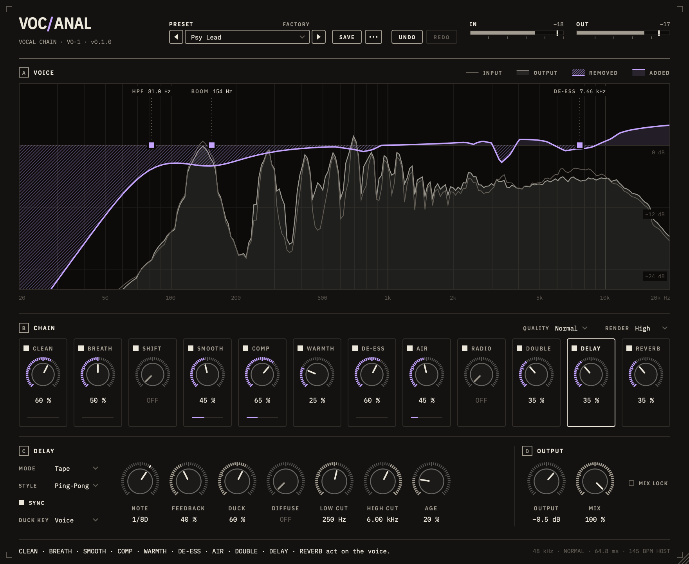

# Vocanal

<Two to four plain sentences: what it is for and how you use it in a session.
BuildApp: "A buildup effect for psytrance. Put it on the loop or the group you
want to build, ride the knobs over the last bars, and pull them back for the
drop." PhaseFucker: what it fixes, where to insert it, where the reference
goes, which button to press.>



<Optional: the signal flow as a small ASCII diagram, e.g. BuildApp's
"in ─┬─ pitch ─ low cut ─ ... ─┐ wet / └── ... ─┤ dry / dry/wet ─ level ─ out".>

VST3 and Audio Unit for macOS (universal), VST3 for Windows. JUCE 8.
<Instrument with a standalone (PsyBox): "Builds as **VST3**, **Audio Unit** and **Standalone** (macOS).">

## The knobs

<Effect: a table, one row per control. Instrument or a workflow plugin: "## Using it"
as numbered steps instead (PhaseFucker: insert, route the sidechain per DAW
(Logic / Ableton Live / Reaper / Cubase), play, press ALIGN, check).>

| Knob | What it does |
|------|--------------|
| **<Name>** | <Range and what it does; what "off" / rest is.> |

<What happens at rest (e.g. "With every knob at rest ... the signal passes bit
for bit"). How every control is handled: drag (Shift for fine), wheel, typed
values on double-click, reset on Alt/Cmd-click; hover help in the footer.>

### The display

- **A — <Section>**: <what is drawn and what each colour means>.
- **B–F**: <...>.

## How it sounds the way it does

<One bold-headed paragraph per DSP block with its source file, e.g.
**Filters** (`src/core/fx/CutFilters.cpp`): the topology, why, and what the
tests measure (numbers: "within 0.25 dB ... up to 17 kHz"). End with the CPU
cost. Sidechain/analysis plugins: "## How the detection works" as numbered
steps.>

## Building

Requirements: macOS 11+, CMake 3.24+, Ninja, Xcode command line tools.

```sh
cmake -B build -G Ninja -DCMAKE_BUILD_TYPE=Release
cmake --build build
```

This installs the VST3 and AU into `~/Library/Audio/Plug-Ins`. JUCE 8 is
downloaded automatically; pass `-DFETCHCONTENT_SOURCE_DIR_JUCE=/path/to/JUCE`
to use a local checkout.

### Core only

The DSP doesn't depend on JUCE and builds in seconds:

```sh
cmake -B build-core -G Ninja -DCMAKE_BUILD_TYPE=Release -DVOCANAL_BUILD_PLUGIN=OFF
cmake --build build-core
./build-core/vocanal_tests
```

### UI snapshots

`build/vocanal_snapshot_artefacts/Release/vocanal_snapshot <dir>`
renders the editor to PNGs (<the states>) with the built-in loop playing
through it, no DAW needed. `... <dir> bench` times the paints instead.

### Trying it without a DAW

```sh
./start.sh               # the built-in kick + bass loop
./start.sh track.wav     # your file, looped
```

`start.sh` builds and opens the demo host: the plugin in a window with the
loop running through it and out of your speakers. **BYPASS** plays it
untouched for comparison; space plays and stops. The plugin gets a matching
looping transport, so anything that follows the DAW's tempo works as in a DAW.

Real samples come from a kit file: copy `demo-kit.example.txt` to
`demo-kit.txt` (ignored by git, sample packs aren't ours to share) and list a
kick, the bass shots (root first, up to three more notes of the same patch),
their tempo and the pattern; `start.sh` picks it up (or set
`VOC_DEMO_KIT`). Without a kit the loop is synthesized
(`tools/PsyLoop.h`). For a configure option on first run:
`VOC_CMAKE_ARGS=-D... ./start.sh`.

### Releases

Push a version tag and GitHub Actions builds, tests and validates the plugins
(pluginval at strictness 5, auval) and attaches the installers to a new
release:

```sh
git tag v1.2.0 && git push origin v1.2.0
```

You get a macOS `.pkg` (universal, VST3 + AU), a Windows setup `.exe` (VST3)
and a zip of the bare plug-ins for each. A suffix such as `v1.2.0-beta.1` makes
it a pre-release. The installer scripts are in `packaging/`.

The macOS build is signed with a Developer ID and notarized when these
repository secrets are set (Settings > Secrets and variables > Actions):

| Secret | Value |
|--------|-------|
| `MACOS_CERTIFICATES_P12` | base64 of a `.p12` holding both the *Developer ID Application* and the *Developer ID Installer* certificate with their keys |
| `MACOS_CERTIFICATES_PASSWORD` | the `.p12` password |
| `NOTARY_APPLE_ID` | Apple ID of the developer account |
| `NOTARY_PASSWORD` | an app-specific password for that Apple ID |

Without them the macOS build is unsigned and macOS blocks the `.pkg` the first
time (System Settings > Privacy & Security > Open Anyway). The Windows
installer is not signed, so SmartScreen asks once (More info > Run anyway).

## Project layout

```
src/core/dsp       <primitives>
src/core/<area>    <the product's DSP>
src/plugin         JUCE processor and editor
src/ui             theme, controls, <views>
tests/             Catch2 tests for the core, test signals
tools/             offscreen UI snapshot tool, demo host
packaging/         macOS pkg and Windows installer scripts
```

## License

The plugin links JUCE 8 under the AGPLv3. IBM Plex fonts under the SIL Open
Font License (`resources/fonts/IBMPlex-OFL.txt`).
